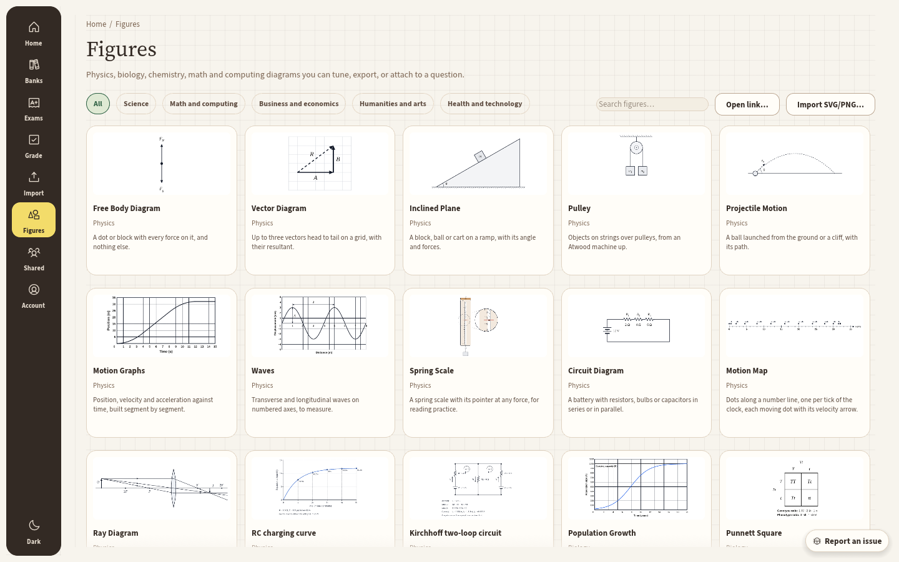

# verSHion

Turn anything into an exam — a pure-Rust desktop clone of [testparrot.com](https://www.testparrot.com/):
question banks, printable exams, and one-shot AI conversion, all local-first.

**Use it in a browser:** <https://vershion.lefthanddev.com>
**Download the desktop build (Linux, alpha):** [releases](https://github.com/shuff57/verSHion/releases/latest) —
one self-contained binary, 64-bit Linux with glibc 2.35+ (`docs/desktop-release.md`).

- **egui + wgpu** (eframe 0.36) single binary; house theme (cream/terracotta, Source Serif/Sans).
- **Question banks**: six question types (multiple choice, true/false, matching, fill-in-the-blank,
  short answer, multipart), topic tags, difficulty, points, images.
- **Exam editor**: page preview with header line, numbered questions and an answer section; open a
  bank in the side panel and click or drag questions onto the exam; undo/redo; heading/text size,
  margins and ruled blanks per exam.
- **Export**: PDF (hand-rolled, embedded Source Serif 4 subsets with real bold/italic faces, embedded images) and DOCX, student test + answer key,
  shuffle question/answer order into named Versions; every export is snapshotted and re-exportable
  from Export History.
- **Imports**: Blackboard test-generator text (`MC/MA/TF/ESS/NUM/MAT/FIB/ORD`, `*` = correct), Aiken,
  CSV and Excel `.xlsx`, Moodle GIFT and Moodle XML, QTI 1.2/2.x/3.0 files and Canvas / Common
  Cartridge / LMS export `.zip`s, Respondus and text2qti text, Quizlet/Anki term lists, Kahoot and
  Brightspace sheets, and real `.parrot.json` Test Parrot packages; paste or file. Grammar and
  mappings: `src/formats.rs` module docs; `VERSHION_PARSE=<file>` prints any file's parse as JSON.
- **AI conversion**: photos, scans and PDF pages become Ditto question banks through the same
  desktop/web workflow. Choose **verSHion AI (account credits)**, **your own key** (OpenRouter,
  Ollama Cloud or a compatible endpoint), or **local Ollama** (the default). Keys saved on the
  desktop are separate from settings and backups; browser keys stay in memory for the tab.
  Strict JSON schemas and native figure tools are optional; existing servers use compatible JSON.
  See `docs/ai-harness-spec.md` for the shared protocol and rollout flags.

Data lives in `${XDG_DATA_HOME:-~/.local/share}/vershion/`. Headless helpers:
`VERSHION_SELFTEST=1`, `VERSHION_SEED=1`, `VERSHION_CONVERT=<file>` (prints import text),
`VERSHION_SCREEN=<welcome|home|banks|bank|exams|exam|imports|figures|settings>` opens that
screen directly (for screenshot/test harnesses).

- **Light & dark**: warm dark palette in the same hue family; the sun/moon switch at the
  bottom of the sidebar persists in `settings.json` (`"dark": true`). The exam page preview
  and figure sheets stay paper-white in dark mode (they preview the printed sheet).
## Building on Linux

Install the [`mold`](https://github.com/rui314/mold) linker first (`sudo dnf install mold`, `sudo apt install mold`):
`.cargo/config.toml` links with it, and the build fails at the link step without it.
